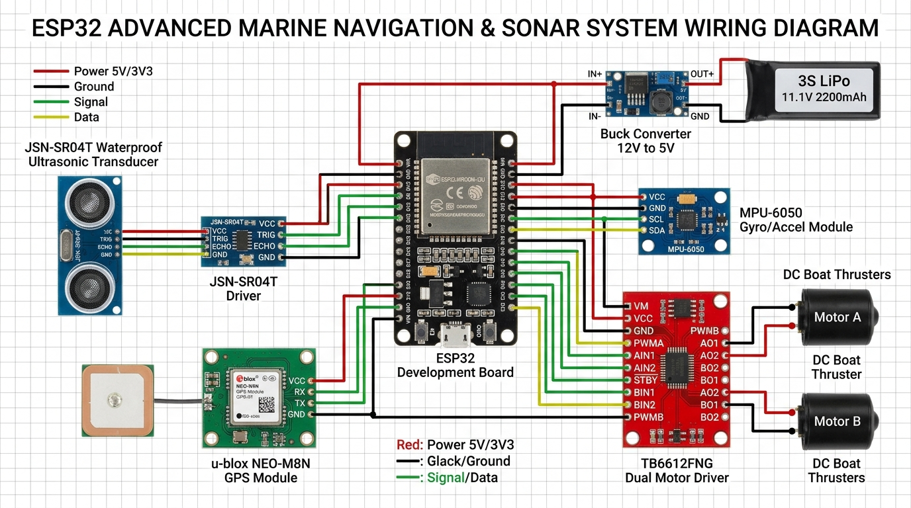

# FloodScout: Autonomous Acoustic Bathymetric & Pothole Hazard Mapping USV

[](docs/COMPETITION_SUBMISSION.md)
[](docs/COMPETITION_SUBMISSION.md)
[](http://www.mountzion.ac.in)
[](LICENSE)

> **Stand-off acoustic sounding survey vessel for detecting and mapping submerged potholes, craters, and open utility trenches in inundated urban road corridors.**

---

## Problem Statement & Context
During monsoon flash floods in Indian urban centers, standing turbid water (10 cm to 1.5 m deep) conceals catastrophic road hazards : deep potholes, washed-away culverts, and open manhole pits. 

Pedestrians, two-wheelers, and emergency response vehicles routinely wade blindly into inundated roads, resulting in severe vehicle drownings, fatal injuries, and transit paralysis. Conventional bathymetric survey boats cost upwards of ₹3,50,000 ($4,200), making them entirely inaccessible for municipal transit departments and local emergency first responders.

**FloodScout** is a lightweight, low-draft catamaran Unmanned Surface Vessel (USV) costing under **₹15,000 ($178)** that allows an operator to stand safely on a dry curb or footpath and deploy an acoustic sounding boat that maps hidden roadbed depth in real time at 10 Hz.

---

## System Architecture & Wiring Diagram

The vessel combines single-beam acoustic sounding with IMU attitude tilt compensation and GNSS spatial georeferencing:



### Subsystem Interconnect Matrix:
```
               +-------------------------------------------+
               |    2S 18650 Li-ion Pack (7.4V / 2500mAh)   |
               +---------------------+---------------------+
                                     |
                                     v
                        [ Sync Buck Converter (5V/3.3V) ]
                                     | (Regulated 5.0V / 3A)
                                     v
+------------------------+    +--------------+    +-----------------------+
| Blue Robotics Ping2    |--->|   ESP32-S3   |<---|  u-blox NEO-M8N GPS   |
|  Acoustic Depth Sensor |    | Dual-Core MCU|    |  Georeferenced Points |
+------------------------+    +-------+------+    +-----------------------+
                                      |
         +----------------------------+----------------------------+
         | (I2C 400kHz)                                            | (PWM LEDC 20kHz)
         v                                                         v
+------------------------+                                +-----------------------+
|   MPU-6050 6-DOF IMU   |                                |  TB6612FNG Dual Driver|
|  Pitch & Roll Tilt     |                                |  Reversible H-Bridge  |
+------------------------+                                +-----------+-----------+
                                                                      |
                                                       +--------------+--------------+
                                                       |                             |
                                                       v                             v
                                            [ Left DC Thruster ]          [ Right DC Thruster ]
```

---

## The Architectural Pivot: Phase 1 vs. Phase 2

A core milestone of this project was the **rigorous real-world failure analysis** of optical depth cameras during Phase 1 exploration, leading to our acoustic pivot:

| Feature / Metric | Phase 1: Optical Exploration (Failed) | Phase 2: FloodScout Acoustic USV (Adopted) |
|:---|:---|:---|
| **Primary Sensor** | Intel RealSense D455f Stereo Depth Camera | Single-Beam Waterproof Acoustic Echosounder |
| **Compute Engine** | NVIDIA Jetson Nano (15W draw) | ESP32-S3 Dual-Core MCU (2.2W total system draw) |
| **Water Penetration** | **Failed in muddy floodwater** (850nm NIR absorbed/scattered within 2 to 5 cm) | **100% Penetration** (Acoustic pressure waves ignore water turbidity & silt) |
| **Power & Weight** | Bulky 12V 10Ah battery pack, 1.8 kg payload | Compact 2S 18650 pack (7.4V / 2500mAh), 75 min continuous endurance |
| **Total Hardware Cost**| > ₹45,000 ($540 USD) | **~₹45,290 (est.)** |
| **Deployment Mode** | Tripod / vehicle rooftop (poor grazing angle) | Low-draft catamaran vessel operating directly on water surface |

*For complete python scripts, OpenCV plane-fitting algorithms, and bench trial photos from Phase 1, see the [`stage1-exploration/`](stage1-exploration/) folder.*

---

## Repository Structure

```
|-- README.md               <- Project master overview & system documentation
|-- LICENSE                 <- MIT Open-Source Hardware/Software License
|-- cad/                    <- Catamaran hull, electronics bay, and motor mount CAD files
|   \-- README.md           <- Mechanical specs & file upload instructions
|-- firmware/               <- Embedded C++ firmware for ESP32
|   |-- floodscout_esp32_firmware.ino <- Core bathymetric sounding & navigation code
|   \-- README.md           <- Compilation and flashing instructions
|-- schematics/             <- Visual circuit diagrams & wiring pinouts
|   |-- circuit_diagram_components.jpg <- High-resolution component wiring diagram
|   \-- WIRING.md           <- Complete pin-by-pin interconnection matrix
|-- bom/                    <- Itemized Bill of Materials
|   |-- BOM.md              <- Hardware cost breakdown (~₹45,290 est.)
|   \-- BOM.csv             <- Spreadsheet-compatible CSV export
|-- stage1-exploration/     <- RealSense D455f + Jetson Nano exploration archives
|   |-- pothole_depth.py    <- Original Python depth-plane algorithm script
|   |-- README.md           <- Failure analysis and acoustic pivot rationale
|   \-- photos/             <- Laboratory and field trial setup photos
\-- docs/                   <- Competition compliance and dossiers
    \-- COMPETITION_SUBMISSION.md <- Vishwakarma Awards 2026-27 Stage 2 audit dossier
```

---

## Bill of Materials Summary (~₹45,290 Estimated Total)

| Component | Subsystem | Quantity | Total (INR) |
|:---|:---|:---:|:---:|
| Blue Robotics Ping2 Sonar (115 kHz, 0.3-30 m) | Bathymetry | 1 | ~₹36,000 |
| ESP32-S3 DevKitC-1 (owned) | Main Compute | 1 | ₹0 |
| ESP32 NodeMCU-32S (Alert Board) | Alert MCU | 1 | ₹500 |
| u-blox NEO-M8N + Ceramic Patch Antenna | Navigation | 1 | ₹1,200 |
| MPU-6050 / BNO055 6-DOF IMU Breakout | Tilt Correction | 1 | ₹350 |
| TB6612FNG Dual H-Bridge Motor Driver | Actuation | 1 | ₹650 |
| Submersible 12V DC Thruster Motors + Props | Propulsion | 2 | ₹2,400 |
| 18650 Li-ion Cells 2500mAh (owned, 2S config) | Power Storage | 2 | ₹0 |
| 2S 7.4V 10A BMS Protection Board | Battery Safety | 1 | ₹150 |
| Synchronous DC-DC Buck Converters (5V / 3.3V) | Voltage Regulation | 2 | ₹220 |
| Twin PVC/XPS Foam Floats + Acrylic Deck | Hull / Chassis | 1 set | ₹1,600 |
| IP67 Waterproof Enclosure + PG7 Glands | Ingress Protection | 1 | ₹850 |
| Conductive Grid Water/Leak Sensor | Leak Detection | 1 | ₹120 |
| 3x LEDs (G/A/R) + Buzzer + Housing | Alert Hardware | 1 set | ₹450 |
| Custom 2-Layer FR4 Prototype PCB | Carrier Board | 1 | ₹800 |
| **TOTAL (Estimated)** | | | **~₹45,290** |

*Full component specifications and supplier links are documented in [`bom/BOM.md`](bom/BOM.md).*

---

## Student Innovation Team
- **Iqraam M** (Lead Embedded Hardware & Bathymetry)
- **Hari Ramachandran V** (Hydrodynamic Catamaran Hull & Structures)
- **Ram Santhosh R** (Telemetry, Algorithms & GIS Hazard Mapping)

### Faculty Mentorship
- **Asst. Prof. A. Sangeetha**, M.Tech., Ph.D.*
  - Assistant Professor, Department of Computer Science & Engineering
  - Mount Zion College of Engineering and Technology (MZCET), Pudukkottai, Tamil Nadu
